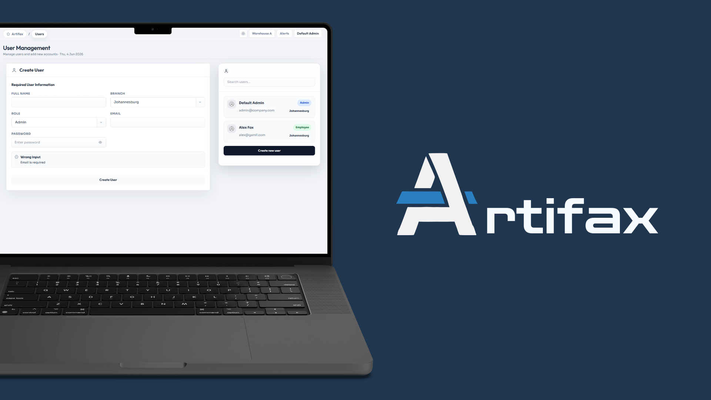

### Table Of Contents
- [Overview](#overview)
- [Installation](#installation)
- [Usage Guide](#usage-guide)
- [Development Process](#development-process)
- [Additional Mockups](#additional-mockups)
- [Test Coverage](#test-coverage)
- [Final Outcome](#final-outcome)
- [Technologies used](#technologies-used)
- [Conclusion](#conclusion)
- [Acknowledgements](#acknowledgements)
## Overview

The purpose of this project report is to present the completed application for the simple and highly reliable inventory management system, Artifax. Developed to avoid unnecessary complication, the system provides a direct approach to tracking internal warehouse operations focusing entirely on internal warehouse components rather than external factors.

The core objective of the system is to deliver a highly scalable backend architecture capable of managing inventory quantities across at least two distinct locations. It enables the tracking of base materials and crafted items, manages production timelines and facilitates structured role-based access control. The system's development was guided by a distinct set of operational needs and analytical wants outlined during initial consultations.


## Installation

### Prerequisites

- **To use the Windows desktop release:** 64-bit Windows, an internet connection, an Artifax user account and [Google Authenticator](https://support.google.com/accounts/answer/1066447) on your phone for two-factor authentication. Ask an Artifax administrator for an account.
- **To run from source:** [Git](https://git-scm.com/downloads) and [Node.js with npm](https://nodejs.org/). Running the backend locally additionally requires the [.NET 10 SDK](https://dotnet.microsoft.com/download/dotnet/10.0) and access to a configured PostgreSQL database, as described below.

No third-party API keys are required.

### Install and run

#### Option 1: Use the Windows desktop release

The desktop app is downloaded and run on your computer. Its frontend source is configured to use a hosted backend API by default; you do not need to run the backend or install PostgreSQL yourself. This is not a hosted website that you can open directly in a browser.

1. Open the [Artifax Releases page](https://github.com/I-Know-What-You-Committed-Last-Summer/Artifax/releases/latest).
2. Under **Assets**, download `Artifax-win32-x64.zip`.
3. Extract the ZIP file, open the extracted folder, and double-click `Artifax.exe`.
4. Sign in with the email address and password supplied by your Artifax administrator.
5. On the verification screen, select **First time?** if you have not set up your authenticator. Scan the displayed QR code with Google Authenticator, enter the six-digit code, and select **Verify Account**. On later sign-ins, enter the current code from your authenticator.
6. Continue to the dashboard. See the [Usage Guide](#usage-guide) for the available screens.

The configured hosted API is `https://artifax-5lqg.onrender.com`. Its availability and the release's connection to it could not be verified from this environment; if sign-in or data loading fails, contact the project maintainers. Access also depends on having an account on that backend.

#### Option 2: Run the frontend from source

The frontend defaults to the hosted API. To use it without running a local backend, ensure the hosted service is available and that you have an account. In a terminal, run:

```bash
git clone https://github.com/I-Know-What-You-Committed-Last-Summer/Artifax.git
cd Artifax/frontend
npm ci
npm exec react-scripts start
```

The React development server opens at [http://localhost:3000](http://localhost:3000). Keep it running, then follow the sign-in steps above. To open the Electron desktop app instead, open another terminal in `Artifax/frontend` and run:

```bash
npm start
```

#### Option 3: Run both backend and frontend locally

PostgreSQL is the database server used to store Artifax data. Install it from [postgresql.org](https://www.postgresql.org/download/) if your database is on your own computer, or use an accessible PostgreSQL server. You also need the server address, port, database name, username, and password for an **existing Artifax database with its tables already set up**.

> The repository contains later database migrations but not the initial schema. Installing PostgreSQL and creating an empty database is therefore not enough. Ask the project maintainers for access to a configured database and an Artifax account before continuing.

1. Clone the repository as shown in option 2. Open a terminal in `Artifax/Backend`, then store the PostgreSQL connection string supplied by the database administrator in .NET User Secrets and start the backend:

   ```bash
   dotnet user-secrets set "ConnectionStrings:ArtifaxDatabase" "<PostgreSQL connection string>"
   dotnet restore
   dotnet dev-certs https --trust
   dotnet run --launch-profile https
   ```

   Replace the placeholder with your actual connection string; do not commit it to the repository. The backend runs at `https://localhost:7040`, with API documentation at [https://localhost:7040/swagger](https://localhost:7040/swagger). Keep this terminal open.

2. Open another terminal in `Artifax/frontend`, install dependencies, and point the frontend to the local backend before starting it:

   **macOS/Linux**

   ```bash
   npm ci
   REACT_APP_API_BASE=https://localhost:7040 npm exec react-scripts start
   ```

   **Windows PowerShell**

   ```powershell
   npm ci
   $env:REACT_APP_API_BASE = "https://localhost:7040"
   npm exec react-scripts start
   ```

   Open [http://localhost:3000](http://localhost:3000) and sign in with an account on your local backend's database. Keep both terminals running. The backend uses secure session cookies, so HTTPS is required for sign-in.

## Usage Guide

<table width="100%">
  <tr>
    <td width="50%" align="center">
      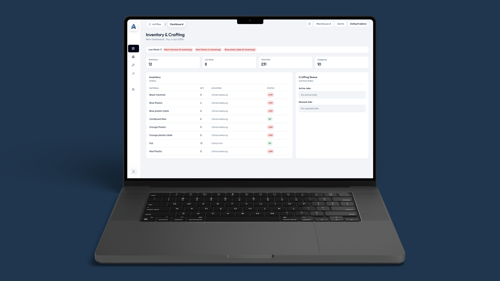
    </td>
    <td width="50%">
      <h3>Dashboard</h3>
      <p>The dashboard provides users with a simplified overview of the inventory, featuring clear labels for low-stock alerts. It also displays currently active jobs and tracks orders waiting in the queue for efficient monitoring.</p>
    </td>
  </tr>

  <tr>
    <td width="50%">
      <h3>Inventory</h3>
      <p>The inventory screen displays all stocked items alongside their relevant information. This ensures quick access to essential details for seamless warehouse management.</p>
    </td>
    <td width="50%" align="center">
      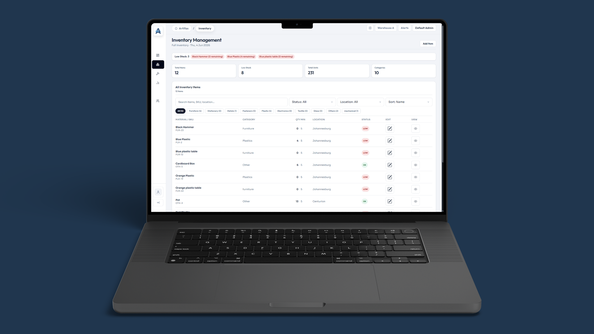
    </td>
  </tr>

  <tr>
    <td width="50%" align="center">
      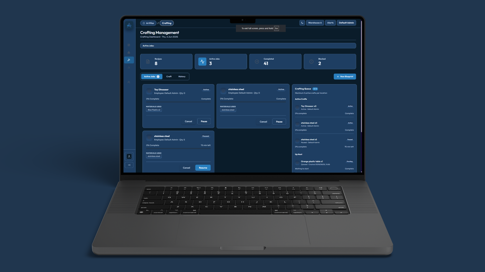
    </td>
    <td width="50%">
      <h3>Crafting: Active Jobs & Queue</h3>
      <p>This section displays actively crafting orders and upcoming queued items. Users can easily pause, cancel, or expedite orders to double the crafting speed as needed.</p>
    </td>
  </tr>

  <tr>
    <td width="50%">
      <h3>Crafting: Blueprints</h3>
      <p>On the blueprint screen, users can select specific blueprints to review their material requirements. It also provides options to initiate a craft, edit, or delete existing blueprints from the system.</p>
    </td>
    <td width="50%" align="center">
      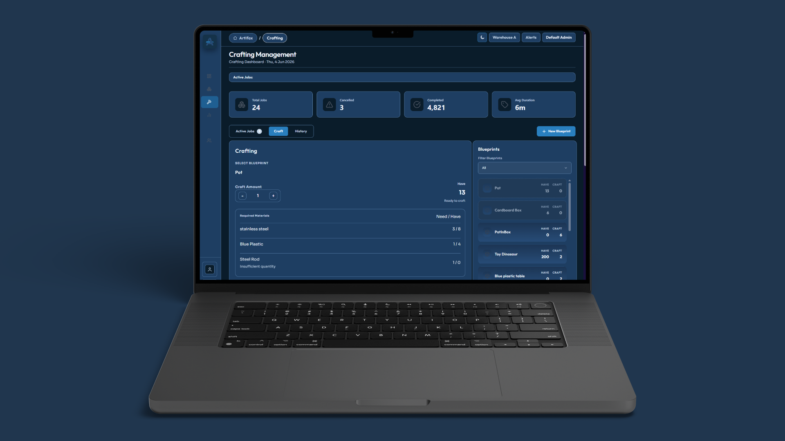
    </td>
  </tr>

  <tr>
    <td width="50%" align="center">
      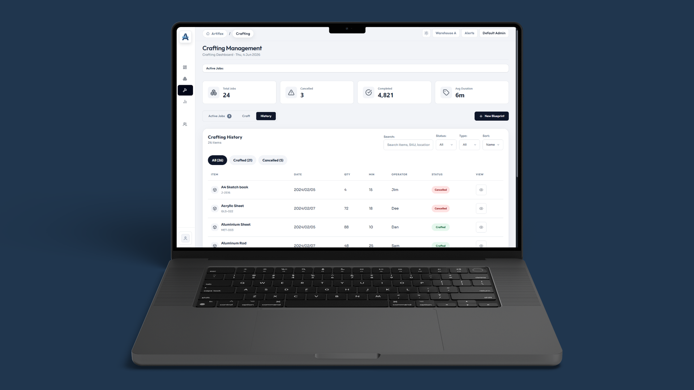
    </td>
    <td width="50%">
      <h3>Crafting: Order History</h3>
      <p>The order history page logs all previous crafting activities for easy reference. Users can review comprehensive details of both completed and cancelled orders from the past.</p>
    </td>
  </tr>

  <tr>
    <td width="50%">
      <h3>New Blueprint</h3>
      <p>This screen allows users to seamlessly add a completely new blueprint to the system. Existing blueprints can also be edited here to ensure crafting requirements are kept up to date.</p>
    </td>
    <td width="50%" align="center">
      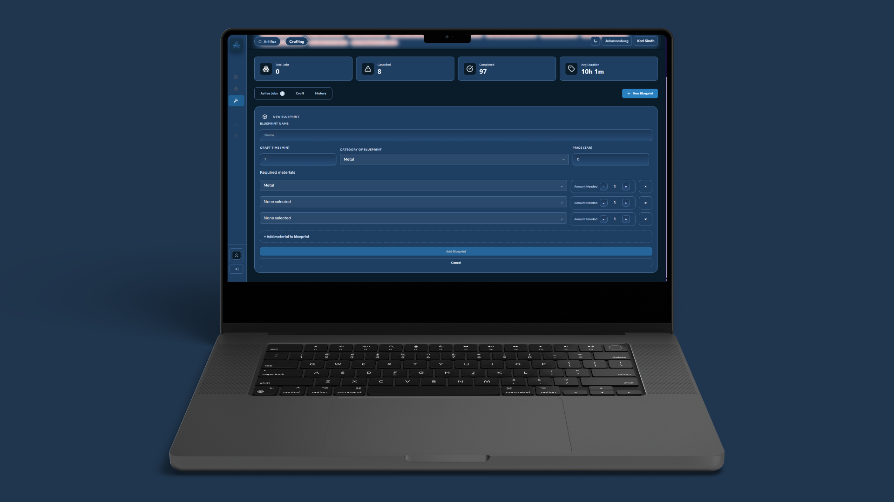
    </td>
  </tr>

  <tr>
    <td width="50%" align="center">
      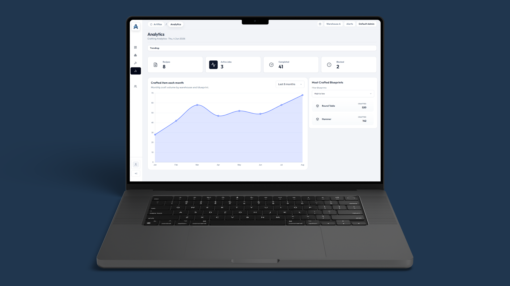
    </td>
    <td width="50%">
      <h3>Analytics (Admin Only)</h3>
      <p>The analytics dashboard provides administrators with valuable insights into crafted item volumes compared to their base costs. It also highlights the most frequently crafted blueprints to help managers optimise production.</p>
    </td>
  </tr>

  <tr>
    <td width="50%">
      <h3>User Management (Admin Only)</h3>
      <p>Administrators can use this page to add new users or assign admin privileges. It also allows for the easy editing or deletion of current user data to maintain secure access control.</p>
    </td>
    <td width="50%" align="center">
      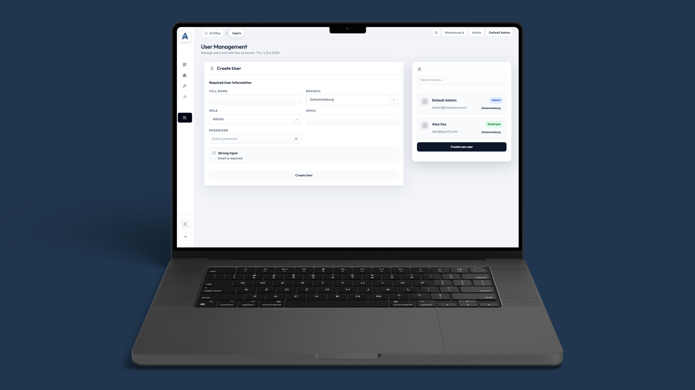
    </td>
  </tr>
</table>


## Development Process

Artifax was developed with warehouse staff and managers in mind. The client needed a simple way to track stock across locations, manage item production, and oversee staff without adding unnecessary complexity. The team used client feedback to refine the data model and authentication approach as the product took shape.

### Product and interface decisions

- **Reduce training and cognitive load:** The interface groups related information into dashboard-style cards and guides users through focused screens for inventory, crafting, analytics, and staff management. A consistent sidebar and shared layout make navigation predictable.
- **Support long shifts and varied work environments:** A calm blue palette, readable typography, large controls, and clear contrast make key information easier to scan. Light and dark themes accommodate different lighting conditions and user preferences.
- **Separate access by responsibility:** Staff and administrators use the same account model, with role-based access to operational and administrative features. Sign-in is followed by a six-digit authenticator check.
- **Keep production visible and manageable:** Crafting blueprints define which ingredients and quantities go into an item. Orders move through a queue, with no more than three active orders per branch, while order history records status changes.

### Application architecture

The desktop client is built with React and Electron. It communicates with an ASP.NET Core API over HTTPS; the API uses Entity Framework Core to access PostgreSQL. The API also runs a background service that updates active order timers, completes finished orders, and starts queued work when a branch has capacity.

The presentation describes the hosted deployment as Electron/React client → Render-hosted ASP.NET API → Aiven-hosted PostgreSQL. The frontend source is configurable to use a hosted API or a local API.

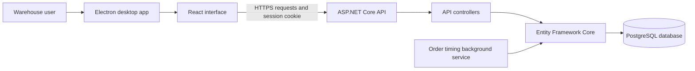

### Sign-in and work flow

After credentials are checked, the user verifies a one-time code from an authenticator app. The API establishes a session and the interface loads the account’s permitted workspace. Operational work then centers on checking stock and blueprints, creating a production order, and tracking it through completion.

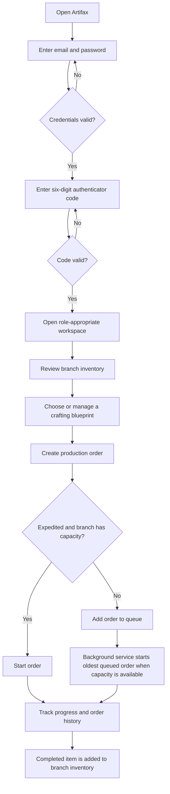

### Data model and design evolution

The first design kept products and raw materials in separate tables. Client feedback surfaced a common production need: an already crafted product might itself be used as an ingredient in another product. Artifax therefore represents both as `Item` records and connects them through `ItemIngredient`. This avoids duplicating the same item and supports multi-step recipes. `BranchItemCapacity` records stock separately for each item at each branch.

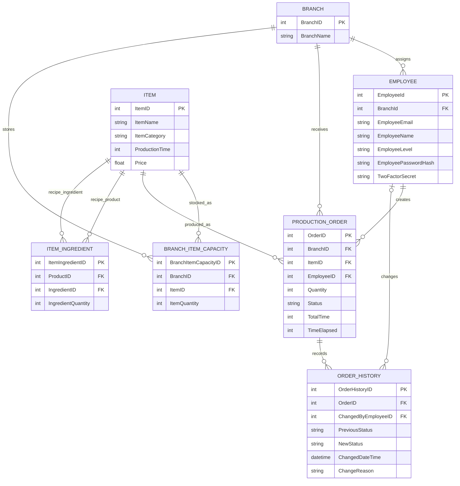

### Challenges and trade-offs

- **Recipe flexibility:** Combining products and materials into one item catalogue makes crafted goods reusable as ingredients. The current model associates one ingredient list with an item; supporting multiple alternative recipes would require a separate blueprint entity.
- **Consistent permissions:** Replacing a separate administrator model with role-based employee accounts simplified sign-in and allowed the same session mechanism to carry each user’s role.
- **Production timing and auditability:** A backend background service advances active orders and moves queued orders into available branch capacity. `OrderHistory` records automatic and user-driven status changes for traceability and reporting.
- **Theme consistency:** Supporting both light and dark appearances requires charts, forms, tables, and navigation to remain readable across themes. The implementation uses shared theme tokens, while a more unified theme system remains an area for future refinement.

## Test Coverage

### Frontend

We implemented unit and integration testing to verify our frontend code, which resulted in 17 passed and 4 failed test suites out of 21 total, and 35 passed and 4 failed individual tests out of 39 total as shown in image. The 4 failing tests belong to features that are still in production, so they are expected to fail until that development wraps up. 

As seen in image, our current code coverage metrics are 57.39% for Statements, 43.63% for Branches, 56.41% for Functions, and 57.9% for Lines, with the uncovered pages currently being fixed and refactored. For the core features that are completely finished like the components tested in BlueprintPanel.test.tsx, CraftingQueue.test.tsx, and NewBlueprint.test.tsx, the tests thoroughly check that data loads correctly from the backend, form buttons lock when inputs are missing and errors are handled safely. 

### Backend

We wrote unit tests throughout the backend on the majority of our controllers that test the functions we use on our endpoints in isolation. Our test suite was built using xUnit and we used both EF’ In-Memory Database and Moq to run our testing. Our total line coverage is only about 30%, but that number is being dropped significantly by files made by Entity Framework Core and Dotnet. We have especially high coverage on all of our controllers. We wrote 77 tests in total, all passed. Every test we wrote follows the Arrange Act Assert pattern to ensure readability and predictability. The tests primarily validated the Controllers.

This included verifying standard CRUD operations, complex relational updates, and ensuring the API returned the correct HTTP status codes for both working results and bad results. These metrics strongly reflect a robust test suite because the coverage wasn't just superficial. The tests thoroughly explored various execution paths, ensuring that our application correctly manipulates the database state (verifying item counts and property changes post-execution) and accurately maps Data Transfer Objects.

### Technologies


In terms of testing we employed a suite of technologies in order to engage in various forms of both manual and automatic. This includes:
- Jest and xUnit for automated testing of our frontend and backend applications. These two technologies were also built in additions to react and dotnet.
- Swagger and Insomnia for manual testing of backend during early to mid and later development accordingly.

## Final Outcome

Artifax brings multi-location inventory tracking, crafting workflows, and role-based management together in a single application.

**How-to-use demo video:** Google Drive link to be added.

## Technologies used

The following section outlines all the technologies used for development and deployment of Artifax. 

---

### Frontend Technologies


- **Node.JS** - Node.js is a powerful runtime environment that allows developers to run JavaScript on the server side, letting you build fast and scalable backend applications outside of a web browser.
- **React** - The foundational JavaScript library used for building the user interface.
- **React Router** - The standard routing library for React. It enables navigation between different pages/views in a Single Page Application (SPA) without reloading the page.
- **Axios** - A promise-based HTTP client used to send requests to backend APIs to fetch, send, or update data.
- **TailwindCSS** - Tailwind CSS is a utility-first CSS framework that allows you to build custom website designs incredibly fast by applying pre-made style classes directly inside your HTML or JSX components.
- **DaisyUI** - A popular component library plugin for Tailwind CSS. It provides ready to use components like buttons, modals, and cards so you don't have to write raw utility classes for everything.
- **PostCSS** - Build tools that work behind the scenes with Tailwind to compile your CSS and automatically add browser vendor prefixes  for cross-browser compatibility.
- **Chart.JS** - A popular JavaScript library used to render flexible, responsive charts (bar, line, pie charts, etc.).
- **Figma** - Figma is a collaborative, cloud based design tool used by product teams to create user interfaces, wireframes, and interactive prototypes for websites and mobile applications in real-time.

---

### Backend Technologies


- **ASP .Net** - .Net was the underlying technology for the establishment of the application’s backend api. It provides us with enterprise level tools that can scale with our growing needs.
    - **Entity Framework Core** - EF Core was primarily used for its ability to connect our application to our database on top of its various relationship modeling tools and migration system.
- **Postgres** - Postgres was the primary tool for creating and modelling our database as it is a highly reliable, open-source object-relational database management system.

---

### Deployment Technologies


- **GitHub Actions** - Github Actions provides us with with the ability to create workflows that to build and deploy our backend api to our Docker container.
- **Docker** - Docker packages applications and their dependencies into standardized, isolated containers. These container could then be passed along to our Render server.
- **Render** - Render is our cloud platform of choice which we used to build and deploy our api contained within our docker application.
- **Electron** - Electron is used for the deployment of the web app in the form of a sharable executable application. 

## Conclusion

Artifax brings inventory tracking, crafting, and staff management into a shared workspace designed for warehouse users with different levels of technical experience. Highlights include stock tracking across branches, blueprint-based production, a queue that manages up to three active orders per branch, and role-based access with two-factor authentication. A focused dashboard, consistent navigation, and light and dark themes aim to make everyday tasks easier to understand.

Client feedback helped us address several challenges. The original database separated products from materials, making it difficult to use a crafted item as an ingredient. We redesigned it around a shared item catalogue and ingredient relationships. We also replaced a separate administrator model with role-based employee accounts, and introduced a background service and order history to track production over time. Maintaining readable, consistent components across both themes required ongoing attention to contrast, spacing, and layout.

Looking ahead, a dedicated blueprint entity could support multiple recipes for the same item. A more unified theming system would make both themes easier to maintain and improve consistency and accessibility. Further work could also expand the client's requested procurement and seasonal-demand analysis and explore visual crafting simulations. Continued user feedback and testing will help guide these improvements as the application evolves.

## Copyright

Copyright © Artifax contributors. All rights reserved. No license is granted to use, copy, modify, or distribute this software without prior written permission.

## Creators

<a href="https://github.com/I-Know-What-You-Committed-Last-Summer/Artifax/graphs/contributors">
  
</a>

## Acknowledgements


Lastly we would like to acknowledge the following people and resources that aided in the creation of the application:

- [Tsungai Katsuro](https://github.com/TsungaiKats)
- William Basson
- Simba Zengeni
- Stack Overflow Community
- Github Copilot
- Google Gemini
